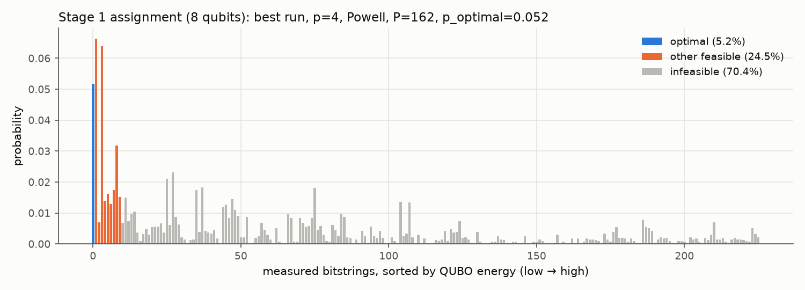
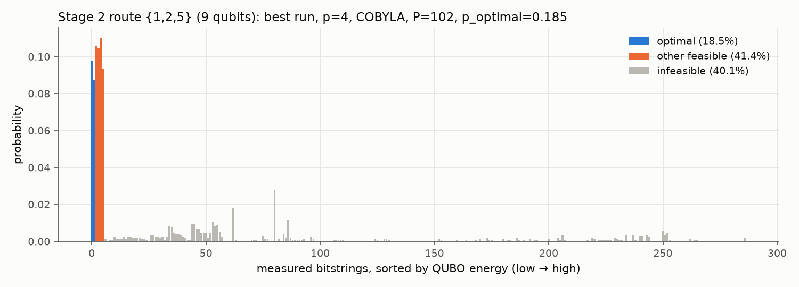
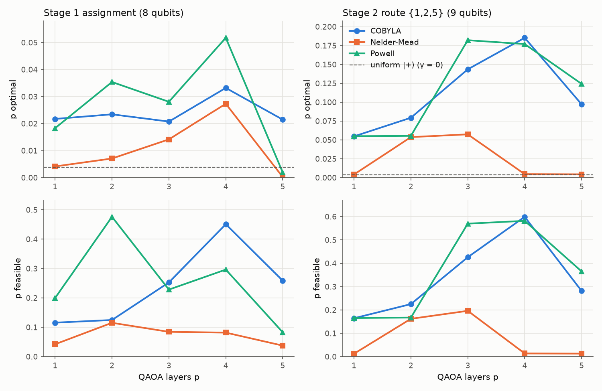

# Logistics domain: small capacitated vehicle routing problem (M2)

*Report section for the group report (CT30A1200, "Quantum Optimization Across Supply Chain, Logistics,
and Industrial Scheduling: A QAOA Study"). Maintained by M2; integrated by M3. Every number below can be
regenerated from this repository (Section 8).*

## 1. Problem and instance

**Problem.** A capacitated vehicle routing problem (CVRP): one depot, a set of customers with demands,
and a fleet of identical vehicles of limited capacity. Every customer is visited exactly once, every route
starts and ends at the depot, and the total travelled distance is minimised.

**Instance.** QOPTLib P-n6_1 [1]: depot 0 and customers 1–5 with 2-D coordinates, capacity $C = 3$.
QOPTLib was designed for quantum solvers and is citable and openly published. The file does not state
demands, the depot or the fleet size; the conventions below were inferred and checked against the
published reference solutions:

| Item | Convention | Evidence |
|---|---|---|
| Depot | first node of the file (index 0) | every reference route starts and ends at 0 |
| Distance | Euclidean, rounded to the nearest integer per edge (TSPLIB `EUC_2D` [2]) | reproduces all 10 QOPTLib reference costs exactly |
| Demand | 1 per customer, so $C$ = max customers per vehicle | no demand section in the file |
| Fleet | $K = 2$ vehicles | every reference solution uses 2 routes |

The reference solution for P-n6_1 (routes 0-1-5-2-0 and 0-4-3-0, cost **118**) is feasible and optimal
under these conventions. For the larger QOPTLib instances (6–7 customers) the published references
violate the capacity or are non-optimal, which is one reason the 5-customer instance was chosen
(full dataset assessment: `data/vrp/README.md`).

## 2. Approach: cluster first, route second

A direct ("monolithic") QUBO for this CVRP needs one binary variable per customer, vehicle and
position, far above the 8–12 variables per quantum run that the project scope allows and that a
statevector simulator handles comfortably. Following the classical cluster-first, route-second
decomposition [3], used with quantum annealers for the CVRP in [4], the problem is split into small QUBOs:

1. **Stage 1, assignment:** which vehicle serves which customer (8 binary variables).
2. **Stage 2, routing:** for each vehicle, the visit order of its customers, a small travelling salesman
   problem with the depot fixed at both ends (9 and 4 binary variables).

Stage 1's solution is decoded and passed to Stage 2; the two route orders form the final solution.
The decomposition is a heuristic: Stage 1 optimises a proxy (distance between customers sharing a
vehicle), not route length. For P-n6_1 the proxy's optimum is the same split as the true optimum,
with a large margin (proxy cost 53 vs 98 for the next split).

## 3. QUBO formulation (TQ1)

A QUBO (quadratic unconstrained binary optimisation) is an energy function
$E(\mathbf{x}) = \sum_i a_i x_i + \sum_{i<j} b_{ij} x_i x_j + c$ over binary $x_i$, to be minimised.
Constraints become penalty terms that are zero when satisfied and positive otherwise [5].

### 3.1 Stage 1: assignment
Variables $x_{i,v} = 1$ if customer $i$ is served by vehicle $v \in \{0, 1\}$.

$$
E_1(\mathbf{x}) = \underbrace{\sum_{v} \sum_{i<j} d_{ij}\, x_{i,v} x_{j,v}}_{\text{intra-vehicle distance}}
+ P_1 \sum_i \Big(\sum_v x_{i,v} - 1\Big)^2
+ P_2 \sum_v \Big(\sum_i x_{i,v} - 2.5\Big)^2
$$

- The second term forces each customer onto exactly one vehicle.
- **Capacity without slack variables.** With $K = 2$, five customers and $C = 3$, every vehicle must
  serve 2 or 3 customers. The target 2.5 gives the same penalty ($0.25 P_2$) to loads 2 and 3 and a larger
  one to every other load, so the inequality is encoded exactly without the extra binary slack variables
  an inequality normally needs. The trick is valid because $C = \lceil n/2 \rceil$; the code refuses
  other combinations.
- **Symmetry breaking.** Relabelling the two vehicles gives the same solution, so customer 1 is fixed to
  vehicle 0. This removes 2 variables: **10 → 8 variables**, 16 couplings.

### 3.2 Stage 2: route of one vehicle
Variables $y_{i,t} = 1$ if customer $i$ is visited at position $t$ ($m$ customers, $m^2$ variables).

$$
E_2(\mathbf{y}) = \sum_i d_{0i}\, y_{i,0} + \sum_{t=0}^{m-2} \sum_{i \ne j} d_{ij}\, y_{i,t}\, y_{j,t+1}
+ \sum_i d_{i0}\, y_{i,m-1}
+ P_a \sum_i \Big(\sum_t y_{i,t} - 1\Big)^2 + P_b \sum_t \Big(\sum_i y_{i,t} - 1\Big)^2
$$

On a valid tour (a permutation matrix) both penalties vanish and $E_2$ equals the route length.
A tour and its reverse have the same cost, so each route QUBO has two optimal bitstrings.

The full expansions into linear and quadratic coefficients are in `domains/vrp/README.md`; unit tests
check every coefficient of the built models against those tables.

### 3.3 Penalty weights
| Weight | Value | Justification |
|---|---|---|
| $P_1 = P_2$ (Stage 1) | 162 | largest total distance from one customer to all others; any single-customer violation then costs more than it saves |
| $P_a = P_b$ (Stage 2) | 102 | $2 \max d_{ij}$; flipping one bit changes at most two legs; valid for every route Stage 1 can produce |

Both are sufficient, not tight: the formulation check (3.4) already passes at 40 (Stage 1) and 60
(Stage 2), and fails below.

### 3.4 Formulation check
Before any quantum run, all $2^n$ bitstrings of each QUBO are enumerated and the lowest-energy
bitstrings are confirmed to be feasible and optimal. This verifies the formulation; it is not used as a
benchmark.

| QUBO | Variables | Feasible / all bitstrings | Lowest-energy bitstring(s) | Energy gap to best infeasible |
|---|---|---|---|---|
| Stage 1 | 8 | 10 / 256 | {1, 2, 5} / {3, 4} (unique) | 140 |
| Route {1, 2, 5} | 9 | 6 / 512 | 0-1-5-2-0 and its reverse | 175 |
| Route {3, 4} | 4 | 2 / 16 | 0-3-4-0 and its reverse | 149 |

Chained, the optima give 45 + 73 = **118**, the QOPTLib reference optimum.

## 4. Quantum implementation (TQ2)

### 4.1 QAOA on Qiskit Aer
QAOA [6] is a hybrid loop, as presented in the course (Quantum_Lecture 2, slides 9 and 16): a classical
computer encodes the problem as a Hamiltonian, a quantum circuit prepares candidate solutions, and a
classical optimiser adjusts the circuit parameters. The implementation is written out explicitly
(`common/solvers.py`) rather than taken from a library wrapper, so every step is visible:

1. **QUBO → Ising.** Substituting $x_i = (1 - z_i)/2$ with $z_i \in \{\pm 1\}$ turns the QUBO into a cost
   Hamiltonian $H = \sum_i h_i Z_i + \sum_{i<j} J_{ij} Z_i Z_j + c$ (`QuadraticProgram.to_ising`).
2. **Normalisation.** $H_C = (H - c)/s$ with $s = \max |h_i|, |J_{ij}|$ ($s$ = 134 for Stage 1, 118 for the route).
   This only rescales the angle $\gamma$, but it keeps $\gamma$ of order 1 regardless of the penalty size (see 6.2).
3. **Ansatz** (`qiskit.circuit.library.qaoa_ansatz`), $p$ layers:
   $|\boldsymbol\gamma, \boldsymbol\beta\rangle = \prod_{k=1}^{p} e^{-i\beta_k H_M} e^{-i\gamma_k H_C}\, |+\rangle^{\otimes n}$,
   with mixer $H_M = \sum_i X_i$.
4. **Training.** SciPy minimises the expected QUBO energy $F(\boldsymbol\gamma, \boldsymbol\beta) = s\,\langle H_C \rangle + c$
   over the $2p$ angles. Aer's `EstimatorV2` returns the exact expectation (noiseless statevector).
5. **Sampling.** The trained circuit is measured 4096 times with Aer's `SamplerV2`. Each bitstring is
   decoded by variable name (Qiskit bitstrings are little-endian), and its QUBO energy and feasibility are recorded.

### 4.2 Simulated annealing (D-Wave `neal`)
The brief allows D-Wave `neal` as the annealing simulator. The project uses its maintained successor,
`dwave.samplers.SimulatedAnnealingSampler`, reported as "neal / simulated annealing". It is a classical
Metropolis algorithm [7] on the same QUBO (each read starts from a random bitstring and accepts uphill
moves less often as the temperature falls), not a simulation of quantum dynamics.

### 4.3 Configuration of the reported run
| Parameter | Value |
|---|---|
| QAOA layers $p$ | 4 (8 angles) |
| Optimiser, budget | Powell [8], 300 energy evaluations |
| Initial angles | $\gamma_k = 1.0$ (normalised units), $\beta_k = 0.4$ |
| Shots | 4096 |
| Seeds | transpiler 1, sampler 1 |
| Annealing | 1000 reads × 1000 sweeps, default geometric β schedule, seed 1 |
| Software | Python 3.14, Qiskit 2.6.0, Qiskit Aer 0.17.2, qiskit-optimization 0.7.0, dimod 0.12.22, dwave-samplers 1.8.0 |

$p = 4$ with Powell was selected by the parameter study in Section 5.2. All settings are in
`configs/vrp.yaml`; every result file stores its settings, seeds and package versions.

## 5. Results

### 5.1 Reported run
`p_optimal` is the share of shots or reads that land on an optimal bitstring; `p_feasible` is the share
that break no constraint. For reference, sampling all bitstrings uniformly (QAOA with $\gamma = 0$)
gives p_optimal = 1/256 ≈ 0.004 (Stage 1) and 2/512 ≈ 0.004 (route {1, 2, 5}).

| QUBO | Qubits | QAOA p_optimal | QAOA p_feasible | CNOTs* | SA p_optimal | SA p_feasible |
|---|---|---|---|---|---|---|
| Stage 1 | 8 | 0.052 | 0.296 | 128 | 0.507 | 0.992 |
| Route {1, 2, 5} | 9 | 0.177 | 0.582 | 240 | 0.395 | 1.000 |
| Route {3, 4} | 4 | 0.828 | 0.828 | 48 | 1.000 | 1.000 |

\* After transpiling to a generic hardware gate set (CNOT, RZ, SX, X); Aer itself runs the circuit natively.

Both pipelines return routes **0-1-5-2-0 and 0-4-3-0** (or reversed), total cost **118**, the optimum.
This should not be read as evidence that QAOA "solves" the problem: the pipeline keeps the
lowest-energy feasible bitstring among 4096 shots, and with only 256–512 possible bitstrings that is
close to enumeration. The share of shots on the optimum (p_optimal) is the meaningful QAOA metric:
13× (Stage 1) and 45× (route) above uniform sampling, but most shots are still not optimal
(Figures 1–2).


*Figure 1. Stage 1, best QAOA run (p = 4, Powell): probability of every measured bitstring, sorted by
energy. Optimal 5.2%, other feasible 24.5%, infeasible 70.4%.*


*Figure 2. Route {1, 2, 5}, best QAOA run (p = 4, COBYLA): optimal 18.5%, other feasible 41.4%, infeasible 40.1%.*

### 5.2 Parameter study
67 QAOA runs (`domains/vrp/sweep.py`, table `results/sweep/summary.csv`) varied one factor at a time
around p = 2, COBYLA [9], 300 evaluations, $\gamma_0 = 1$:

| Factor | Stage 1 (8 qubits) | Route {1, 2, 5} (9 qubits) |
|---|---|---|
| Depth p = 1…5 | p_optimal 0.02–0.05, no clear trend; best p = 4 Powell 0.052 | 0.055 → 0.18 at p = 3–4, then 0.12 at p = 5 |
| Optimiser | Powell ≥ COBYLA > Nelder-Mead [10] | COBYLA ≈ Powell ≫ Nelder-Mead (≈ uniform at p ≥ 4) |
| Evaluation budget 25…1000 | COBYLA and Powell stop by themselves at ~230–260 | COBYLA converges within 68 evaluations |
| Initial $\gamma$ 0.1 / 0.4 / 1 / 2 | 0.011 / 0.020 / 0.023 / 0.013 | 0.079 / 0.029 / 0.079 / 0.145 |
| Penalty P | 40–250: 0.002–0.028, not monotone | 60–150: 0.074–0.079, flat |


*Figure 3. p_optimal (top) and p_feasible (bottom) against the number of QAOA layers, per optimiser.
Dashed line: uniform sampling.*

Further figures: `results/sweep/fig_budget.png`, `fig_gamma.png`, `fig_penalty.png`.

## 6. Practical challenges (TQ3)

### 6.1 Circuit depth
Each QAOA layer applies one two-qubit rotation per QUBO coupling, i.e. 2 CNOTs per coupling on generic
hardware: 32 CNOTs per layer for Stage 1 (16 couplings) and 60 for the 9-qubit route (30 couplings).
The best route run (p = 4) needs 240 CNOTs. On the noiseless simulator depth only costs runtime
(1–9 s per run); on current hardware, errors accumulated over hundreds of CNOTs would likely erase
the small probability advantage observed here.

### 6.2 Parameter tuning
- **Angle scale.** Penalties make the Ising coefficients large (up to 134), so without normalisation
  $\gamma$ must be about 0.003, while COBYLA's first step is 1.0. In the first run (p = 2, COBYLA, no
  normalisation) only 2 of 4096 shots hit the optimal route, fewer than uniform sampling would give.
  Normalising the cost Hamiltonian raised p_optimal on the same settings from 0.0005 to 0.079.
- **Initialisation.** The starting $\gamma$ alone changes route p_optimal by 5×; each setting used one
  starting point, so individual values are noisy. Multi-start or layer-by-layer initialisation is the
  natural next step and was not run.
- **Depth vs trainability.** More layers help the route up to p = 3–4; at p = 5 (10 angles) a
  300-evaluation budget runs out before convergence, and Nelder-Mead degrades to uniform sampling.
- **Penalty weights.** After normalisation, the penalty weight within the valid range had no systematic
  effect; the shape of the landscape, not P, decided the outcome.

### 6.3 Encoding
- One-hot position encoding makes almost all bitstrings infeasible: 6 of 512 for a 3-customer route
  (98.8% infeasible), growing as $m!/2^{m^2}$. Even the best QAOA run leaves 40% of its shots infeasible.
- The capacity inequality was encoded without slack variables (3.1), which kept Stage 1 at 8 qubits.
  This relies on the specific instance ($K = 2$, $C = \lceil n/2 \rceil$); general demands would need
  slack variables and more qubits.
- Symmetries (vehicle relabelling, tour reversal) waste qubits or create degenerate optima; one was
  removed by fixing a variable, the other was kept.

### 6.4 Simulator limits
Statevector simulation stores $2^n$ complex amplitudes, so memory doubles per qubit; the course notes a
practical ceiling of about 30–40 qubits (Lecture 6, slide 8). A monolithic QUBO for this 5-customer
instance would already exceed the 8–12-variable scope, which is why the problem was decomposed. The
simulator is also noiseless and returns exact expectation values, so these results are an upper bound
on what hardware would achieve with the same circuits.

## 7. Limitations
- **Decomposition.** Stage 1 optimises a proxy; it matches the optimum here, but cluster-first,
  route-second is a heuristic and is not optimal in general.
- **Statistics.** One starting point and one sampler seed per setting; run-to-run variation was not
  measured, so small differences in p_optimal should not be over-interpreted.
- **Metric.** "Best of 4096 shots" overstates QAOA at this size; p_optimal and p_feasible are reported instead.
- **Scope.** Simulators only, one small instance, no comparison with classical solvers (by design of the brief).

## 8. Reproducibility
```
conda activate qsenv314        # or any Python 3.12–3.14 env
pip install -r requirements.txt
python -m pytest -q            # 21 tests, includes all formulation checks
python -m domains.vrp.run --config configs/vrp.yaml       # reported run (Section 5.1)
python -m domains.vrp.sweep --config configs/vrp.yaml     # parameter study (Section 5.2)
```
All seeds are fixed in `configs/vrp.yaml`; re-running reproduces the reported numbers exactly.

## References
[1] E. Osaba, E. Villar-Rodriguez, "QOPTLib: a Quantum Computing Oriented Benchmark for Combinatorial
Optimization Problems," in *Benchmarks and Hybrid Algorithms in Optimization and Applications*,
Springer, 2023, pp. 49–63. arXiv:2404.15852. Data: doi:10.17632/h32z9kcz3s.1.
[2] G. Reinelt, "TSPLIB — A Traveling Salesman Problem Library," *ORSA Journal on Computing* 3(4), 376–384, 1991.
[3] M. L. Fisher, R. Jaikumar, "A generalized assignment heuristic for vehicle routing," *Networks* 11(2), 109–124, 1981.
[4] S. Feld et al., "A Hybrid Solution Method for the Capacitated Vehicle Routing Problem Using a Quantum
Annealer," *Frontiers in ICT* 6:13, 2019.
[5] A. Lucas, "Ising formulations of many NP problems," *Frontiers in Physics* 2:5, 2014.
[6] E. Farhi, J. Goldstone, S. Gutmann, "A Quantum Approximate Optimization Algorithm," arXiv:1411.4028, 2014.
[7] S. Kirkpatrick, C. D. Gelatt, M. P. Vecchi, "Optimization by Simulated Annealing," *Science* 220(4598), 671–680, 1983.
[8] M. J. D. Powell, "An efficient method for finding the minimum of a function of several variables without
calculating derivatives," *The Computer Journal* 7(2), 155–162, 1964.
[9] M. J. D. Powell, "A direct search optimization method that models the objective and constraint functions
by linear interpolation," in *Advances in Optimization and Numerical Analysis*, Springer, 1994, pp. 51–67.
[10] J. A. Nelder, R. Mead, "A simplex method for function minimization," *The Computer Journal* 7(4), 308–313, 1965.
Qiskit: A. Javadi-Abhari et al., "Quantum computing with Qiskit," arXiv:2405.08810, 2024.
Course slides: CT30A1200, Quantum_Lecture 2 (slides 9, 16), Lecture 6 (slide 8).
